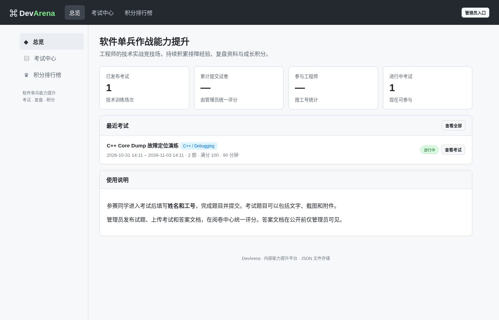
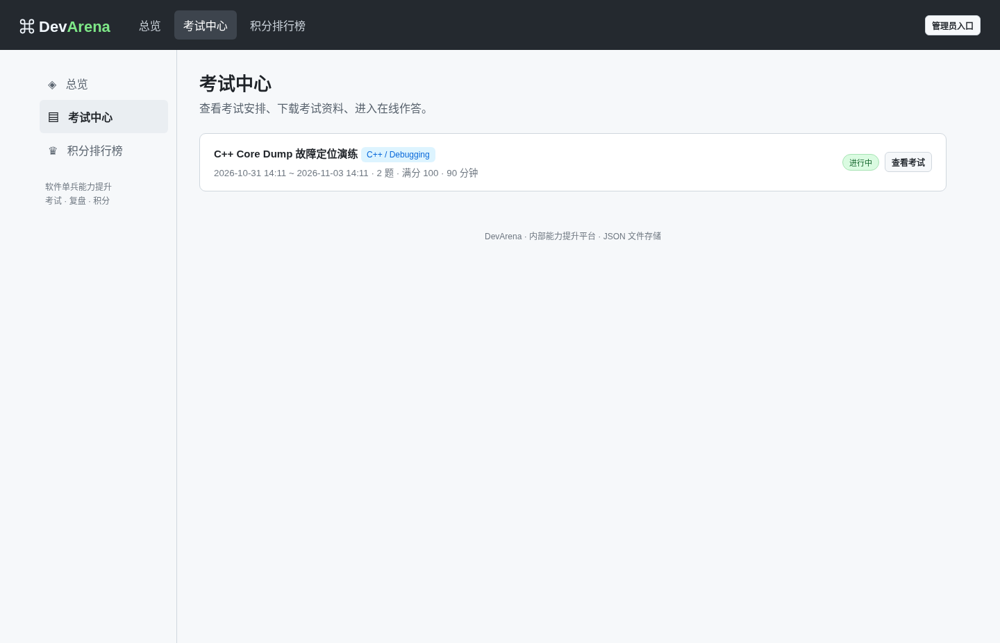
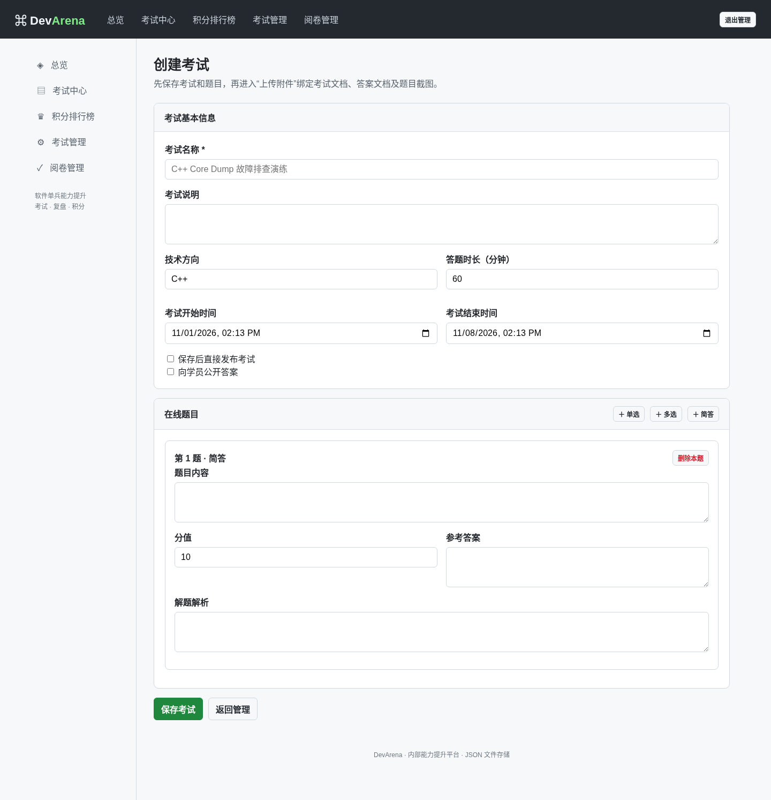
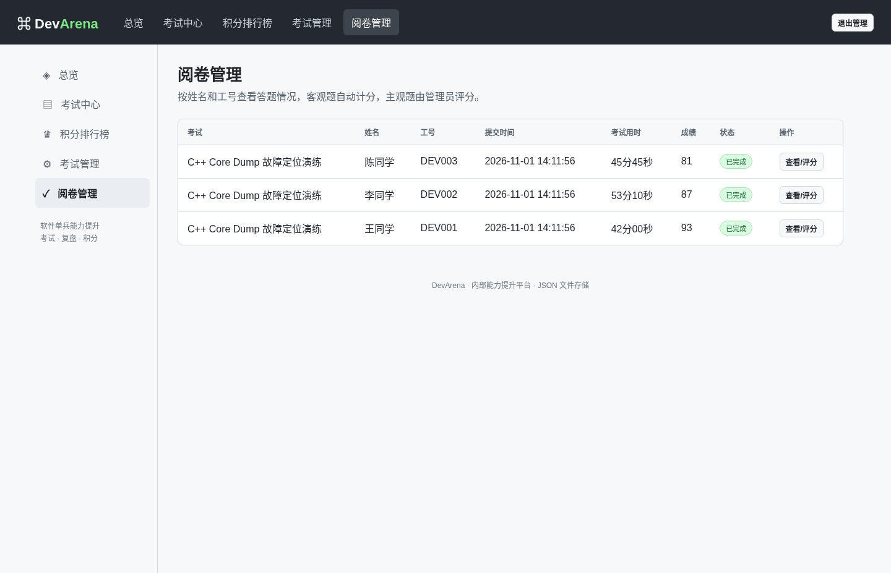
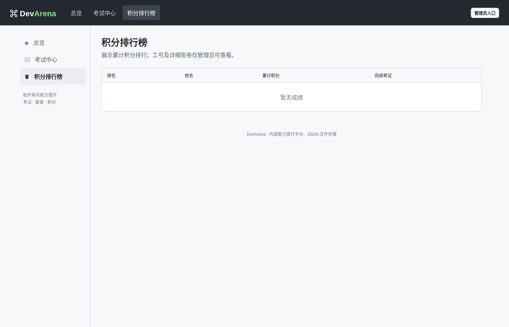

<div align="center">

# 🏟️ DevArena

### 软件单兵作战能力提升 · 在线考试与积分平台

**题目沉淀 · 在线作答 · 文档归档 · 人工阅卷 · 用时统计 · 积分排名**

   

轻量级内部技术实战训练平台。无需数据库、无需前端构建、无需第三方 Python 包。

</div>

## 📖 项目介绍

DevArena 面向软件研发团队的持续技术能力建设，将 C++ Core Dump 排障、内存泄漏定位、并发问题分析等内部实战训练统一管理。管理员发布考试、上传考试材料及参考答案，员工在线作答；系统记录作答时长，管理员统一阅卷，考试成绩自动累计为积分榜。历史题目和答案可按公开策略沉淀为知识资产。

> **部署定位**：面向可信公司内网或 VPN 的轻量应用；生产使用建议启用公司 OAuth2、HTTPS 和定期备份。未接入企业身份认证时，仅建议在受控测试网络试运行。

## 🖥️ 界面展示

> 以下截图使用演示数据，**不包含真实员工资料或公司内部试题**。

**平台总览**



**考试中心与题目管理**

| 考试中心 | 管理员创建考试 |
| :---: | :---: |
|  |  |

**阅卷管理与积分排名**

| 阅卷管理（含考试用时） | 积分排行榜 |
| :---: | :---: |
|  |  |

## ✨ 主要功能

| 模块 | 功能 |
| --- | --- |
| 考试管理 | 新建、编辑、发布与取消发布，配置考试窗口、答题时长和分数 |
| 在线试题 | 单选、多选、简答题；题干、选项、参考答案和解析 |
| 附件管理 | 上传考试文档、答案文档、题目截图及相关文件；单文件上限由 `app_config.json` 配置（默认 8 GB） |
| 在线答题 | 学员录入姓名、工号，按考试时段开始与提交；同一场考试按工号避免重复提交 |
| 学生文档答卷 | 考生可在考试中上传 PDF、Word、Markdown、ZIP、日志、Core Dump 等附件；提交后归档到答卷中，管理员可在阅卷页面下载 |
| 阅卷评分 | 客观题自动评分；主观题由管理员填写总得分和评语 |
| 考试计时 | 服务端记录开始、提交时间，统计每位学生的实际作答时长；刷新不重新计时 |
| 排行榜 | 已完成评分的考试成绩累计为积分，按累计分排序 |
| 答案公开 | 管理员控制标准答案与答案附件是否向学员公开 |
| 企业登录 | 可选 OAuth2 Authorization Code + PKCE，支持员工身份字段和管理员白名单映射 |
| 数据存储 | JSON 文件保存考试、答卷、积分来源和考试计时；本地目录保存附件 |

**当前版本范围**：暂不提供个人主页；无数据库服务；不支持学生上传答卷附件；主观题以整份试卷的主观题总分评分（非逐题评分）。

## 🧱 技术架构

```text
浏览器 (HTML / CSS / JavaScript)
           │
           │  HTTP / HTTPS (经反向代理)
           ▼
Python 3 标准库 HTTP Server (server.py)
           │
           ├── /api/*       考试、答题、阅卷、文件接口
           ├── /auth/*      OAuth2 登录、回调与登出
           │
           └── data/
               ├── state.json     考试 / 提交 / 计时等结构化数据
               └── uploads/      考试文档 / 答案 / 题目附件
```

无需 MySQL、Redis、Node.js 或 `pip install`。**注意**：虽然不需要传统后端框架，跨设备共享 JSON 数据仍由 `server.py` 负责读写；仅双击打开 `index.html` 无法实现多人考试。

## 🚀 快速部署（Linux）

### 1. 环境要求

- Linux 服务器（或 macOS / Windows），推荐 Python **3.9+**。
- 浏览器：现代 Chrome、Edge、Firefox 或 Safari。
- 服务器到参与员工的网络可达，目标端口已按内网策略放行。

### 2. 获取代码

```bash
git clone https://github.com/<YOUR_ORG>/<YOUR_REPO>.git
cd <YOUR_REPO>
```

> 将占位符替换成你实际的 GitHub 仓库地址。如果下载的是 ZIP，解压并 `cd` 到包含 `server.py` 的目录即可。

### 3. 启动

```bash
chmod +x start.sh
./start.sh 8080
```

打开 `http://127.0.0.1:8080`。内网其他电脑可访问：

```text
http://<服务器内网IP>:8080
```

`start.sh` 默认监听 `0.0.0.0`；端口不写时默认为 `8080`。请仅向获准访问的网络开放端口。

**无需 shell 脚本也可以运行：**

```bash
python3 server.py --host 0.0.0.0 --port 8080
```

**Windows：** 在目录下运行 `start.bat 8080`（需要 Python 3 和 `py` 启动器）。

### 4. 配置最大上传文件大小（Core Dump）

在项目根目录编辑 `app_config.json`：

```json
{
  "max_upload_mb": 8192
}
```

`max_upload_mb` 的单位为 **MB（MiB，1024² 字节）**，默认 **8192 MB（8 GiB）**。例如需要支持单个 16 GiB 的 Core Dump，将其改为 `16384`。有效范围为 1–65536（最大 64 GiB）。修改配置后**重启 Python 服务**生效；前端上传提示会从服务端同步读取。

上传与下载均采用 **4 MiB 分块流式处理**，不会一次性把整个 Core Dump 读入 Python 内存；上传失败时会清理未完成的临时文件。注意预留磁盘空间。

如果使用 Nginx / 公司网关，还必须同步调整反向代理的请求体限制与超时设置（参考下方 Nginx 示例）；否则可能收到 `413 Request Entity Too Large`。例如上限改为 16 GiB 时使用 `client_max_body_size 16384m;`。

### 5. 使用 nohup 后台启动（Linux）

```bash
# 在仓库根目录，端口默认 8080
bash start-background.sh start 8080

# 查看服务状态
bash start-background.sh status

# 实时查看日志
bash start-background.sh logs

# 重启以加载更新后的 app_config.json
bash start-background.sh restart 8080

# 停止服务
bash start-background.sh stop
```

脚本通过 `nohup` 启动 `python3 -u server.py`，将运行日志追加到 `devarena.log`，进程号写入 `devarena.pid`；关闭 SSH 终端后网站仍继续运行。日志和 PID 文件已添加到 `.gitignore`。请勿在同一端口同时运行前台与后台实例。

如果想直接使用原生 `nohup` 指令：

```bash
nohup python3 -u server.py --host 0.0.0.0 --port 8080 > devarena.log 2>&1 < /dev/null &
```

服务器重启自动恢复应使用下文的 `systemd`，`nohup` 本身不提供开机自启。

### 6. 体验考试流程

1. 管理员进入「考试管理」创建考试，选择单选、多选或简答题，设置开始/结束时间并保存。
2. 通过「上传附件」添加考试文档、标准答案文档和题目截图；可将附件关联指定题目。
3. 发布考试后，学员进入「考试中心」，输入姓名和工号并点击开始考试。
4. 提交后，管理员在「阅卷管理」查看答卷、用时，填写主观题得分与评语。
5. 完成评分后，成绩进入「积分排行榜」；管理员可单独决定何时公开标准答案。

### 7. 后台常驻与开机自启（可选：systemd）

将下列示例保存为 `/etc/systemd/system/devarena.service`，把路径和运行用户改为实际值：

```ini
[Unit]
Description=DevArena Exam Platform
After=network.target

[Service]
Type=simple
User=devarena
WorkingDirectory=/opt/devarena
ExecStart=/usr/bin/python3 /opt/devarena/server.py --host 127.0.0.1 --port 8080
Restart=on-failure
RestartSec=3

[Install]
WantedBy=multi-user.target
```

```bash
sudo systemctl daemon-reload
sudo systemctl enable --now devarena
sudo systemctl status devarena
sudo journalctl -u devarena -f
```

此示例仅监听本机端口，预期由公司内网反向代理转发。如果不使用代理，请根据网络策略修改监听地址；确保运行用户对 `data/` 有写权限。

## 🔐 企业 OAuth2 接入

平台已提供**标准 OAuth2 Authorization Code + PKCE** 的配置化适配，接入公司身份平台时不需要改写前端页面。

### 1. 复制配置

```bash
cp oauth_config.example.json oauth_config.json
chmod 600 oauth_config.json
```

### 2. 按公司身份平台信息填写

| 配置字段 | 需要填写的内容 |
| --- | --- |
| `enabled` | 启用时设为 `true` |
| `client_id` / `client_secret` | OAuth2 应用 ID / 密钥 |
| `authorization_endpoint` | 授权页面地址（HTTPS） |
| `token_endpoint` | 授权码换 Token 地址（HTTPS） |
| `userinfo_endpoint` | 使用 Access Token 获取员工身份信息的地址（HTTPS） |
| `redirect_uri` | 应用回调地址，如 `https://exam.example.internal/auth/callback` |
| `scopes` | 公司 IdP 允许的权限范围 |
| `identity_claim` | **不可变、唯一**的账号字段，如 `sub` |
| `name_claim` | 姓名字段，如 `name` |
| `employee_id_claim` | 工号字段，如 `employee_id` 或 `profile.employee_id` |
| `admin_subjects` | 管理员唯一账号 ID 白名单 |
| `admin_employee_ids` | 可选：管理员工号白名单 |
| `token_auth_method` | `client_secret_basic`（默认）、`client_secret_post` 或 `none` |
| `session_hours` | 会话有效期（小时） |
| `cookie_secure` | HTTPS 环境应为 `true` |

修改后重启服务。**不要把 `oauth_config.json`、Client Secret、访问令牌或真实用户资料提交到 GitHub。** 仓库只放 `oauth_config.example.json`。

### 3. 反向代理 HTTPS（示例）

企业 OAuth2 模式要求外部回调是 HTTPS，通常在 Nginx 或公司统一网关终止 TLS：

```nginx
server {
    listen 443 ssl;
    server_name exam.example.internal;

    ssl_certificate     /path/to/company-cert.pem;
    ssl_certificate_key /path/to/company-key.pem;

    location / {
        proxy_pass http://127.0.0.1:8080;
        proxy_set_header Host $host;
        proxy_set_header X-Forwarded-Proto https;
        proxy_set_header X-Real-IP $remote_addr;
        client_max_body_size 8192m;
        proxy_request_buffering off;
        proxy_read_timeout 3600s;
        proxy_send_timeout 3600s;
    }
}
```

此示例需要按公司内网 DNS、证书、网关和安全规范调整，并在身份平台**精确登记** `redirect_uri`。服务端必须能访问 Token / UserInfo 地址；员工浏览器必须能访问授权页面及回调域名。若公司使用内网 CA，服务器还需要信任对应证书链。

> **兼容范围说明**：目前使用标准授权码 + PKCE，并从 UserInfo 接口读取身份字段；尚未连接真实公司 IdP 联调，也不做 ID Token 的本地验签。如果公司接口不是标准 UserInfo 返回格式、采用额外签名/特殊鉴权或需自定义字段转换，应根据接口文档再做适配。OAuth2 模式下管理员权限来自账号/工号白名单；不再使用本地固定密码。

## 📎 学生上传答卷和附件删除

- 考生点击 **开始考试** 后，在在线答题页面通过「上传答卷 / 分析报告」选择多个文件上传。文件大小服从 `app_config.json` 的 `max_upload_mb`；上传和下载采用服务端分块传输。
- 上传成功后，考生可以下载或**删除自己尚未提交**的附件；重新进入考试时，已上传的附件列表会恢复。
- 提交试卷时，系统把该场考试的附件与提交记录绑定。此后学员不可自行修改已归档的附件，**管理员**在阅卷详情可以下载或删除。
- 考试文档、答案文档、题目截图与相关文件也都有管理员「删除」按钮。删除会同时移除 JSON 元数据与磁盘中的原始文件，**不可撤销**。
- 附件保存在 `data/uploads/`，元数据保存在 `data/state.json` 的 `files` 数组。学生文件类别为 `kind: "submission"`，未提交时与 `attemptId` 关联，提交后增加 `submissionId`。历史文件和成绩不需要迁移。
- 非管理员的公开状态接口不会返回学生附件元数据；下载学生附件须具备该考试的有效作答会话。没有开启公司 OAuth2 时，姓名和工号并非可靠身份认证，请仅在可信内网使用。

## 🔄 现有考试数据平滑升级（Linux）

**先在独立目录获取新版源码**，不要直接覆盖原安装目录的 `data/` 或 `oauth_config.json`。

```bash
# 示意：在 /tmp 下获取包含本功能的新版本
git clone https://github.com/niehmanyo/devarena.git /tmp/devarena-new
cd /tmp/devarena-new
git checkout feature/student-documents-safe-upgrade

# /opt/devarena 是当前已经部署并持有历史数据的旧目录
bash upgrade.sh /opt/devarena 8080
```

升级脚本完成以下操作：

1. 检查旧的 `data/state.json` 是有效 JSON，并验证考试/成绩/附件字段的基本结构。
2. 如果旧服务由 `start-background.sh` 管理，则停止服务。
3. 在旧项目同级目录创建带时间戳的备份目录，例如 `/opt/devarena-backups/20261109-160000/`；保留旧代码、OAuth2 配置和上传数据。
4. 只替换 `server.py`、`index.html`、启动脚本及文档；不覆盖 `data/`、现有的 `app_config.json` 和 `oauth_config.json`。
5. 进行 Python 语法检查与 JSON 校验，再通过 `nohup` 启动原端口上的服务。
6. 如果检查或启动失败，尝试恢复旧代码；备份目录仍保留，便于人工恢复。

**注意**：如果原服务是用手工 `nohup ./start.sh`、systemd 或其他方式启动，而非 `start-background.sh`，请先通过原启动方式停掉旧进程，再执行升级，避免端口占用。升级前应确保磁盘剩余空间充足。备份优先使用 Linux 硬链接保存大型文件，避免重复占用多个 GB；该方式适用于 DevArena 上传后不原地修改附件的存储模式。对于更高数据保护要求，请额外创建离线独立备份。

完成后检查：

```bash
cd /opt/devarena
bash start-background.sh status
bash start-background.sh logs
```

检查旧考试、成绩及附件是否仍然存在，再试传一份学生报告并在管理员阅卷页面确认关联。

## 🗃️ 文件结构与数据备份

```text
.
├── index.html                   # 单页前端
├── server.py                    # Python HTTP / API / OAuth2 服务
├── start.sh                     # Linux / macOS 前台启动
├── start-background.sh          # Linux nohup 后台运行、停止和查看日志
├── app_config.json              # 上传上限（MB），默认 8192
├── start.bat                    # Windows 启动
├── oauth_config.example.json    # OAuth2 配置模板（不包含真实密钥）
├── .gitignore
├── docs/
│   └── images/                  # README 演示截图
├── README.md
└── data/                        # 运行时创建；不提交 GitHub
    ├── state.json               # JSON 业务数据
    └── uploads/                 # 文件附件
```

备份时应**同时保存整个 `data/` 文件夹**（仅备份 `state.json` 会遗漏附件）：

```bash
# 建议在服务停止或确保文件写入静止时进行一致性备份
cp -a data "data-backup-$(date +%Y%m%d-%H%M%S)"
```

恢复/更新版本时保留 `data/`，不要用演示数据覆盖生产数据。`oauth_config.json` 应单独安全备份，不应公开分享。运行时生成的 `data/`、`oauth_config.json` 已由 `.gitignore` 忽略；但**已经被 Git 跟踪的敏感文件仍须从索引和历史中清理**。

## ⏱️ 考试用时计算

- 点击「开始考试」：服务端记录 `startedAt` / `startedTs` 到 `attempts`。
- 点击「提交试卷」：服务端计算并保存 `durationSeconds`，与成绩一起在管理员阅卷页展示。
- 同一考试同一工号重复进入不会清零开始时间；超过答题时限或考试结束时间会拒绝提交（存在少量网络宽限）。
- 旧版历史记录若没有开始时间，界面明确显示「历史数据未统计」。

## ⚠️ 安全与已知限制

- **仓库公开前先检查保密要求**：项目设计用于公司内部；真实试题、员工姓名工号、OAuth2 密钥、考试答案和上传附件均不应提交公开仓库。
- 未启用 OAuth2 时，旧版管理员入口使用代码内固定密码 `dbzz123`，**不具备生产级安全性**；请在可信受控环境测试，不要暴露公网。公司内部正式使用应启用 OAuth2 并做好网关访问限制。
- OAuth2 模式下，建议映射 `employee_id_claim`，避免用户自由填写他人工号；姓名输入目前仍可编辑。
- 单机 JSON 存储适合小团队使用，不适合多服务器实例共享写入、规模化高并发或强审计需求；请定期备份。
- OAuth 会话保存在进程内存中，服务重启会要求重新登录，但已保存的考试开始时间和试卷不会因此清空。
- 答题用时是**开始到提交的经过时间**，并非浏览器持续活跃或专注答题时间。
- 若需直接暴露公网、强身份审计或高强度反作弊，请先做专门的安全评估与服务端增强。

## 🛠️ 后续规划

- [ ] 逐题主观评分与评分细则
- [ ] 学生上传分析报告 / Core Dump 附件
- [ ] 个人成长档案与能力趋势
- [ ] 管理员导出成绩与考试用时（CSV / Excel）
- [ ] OAuth2 与公司实际身份平台联调

---

<div align="center">

**DevArena** · Practice · Review · Improve

</div>

## 结构化考题描述（v5.3）

管理员在 **考试管理 → 创建/编辑考试 → 新增题目** 中，除题目标题、题型、分值及标准答案外，还可以填写：

- **考题描述**：本题要解决的核心问题与目标。
- **场景背景 / 问题现象**：运行环境、故障日志、复现条件。
- **任务要求**：需要分析、定位与解释的内容。
- **提交内容 / 格式要求**：答卷应包含的结论、证据或报告。
- **考察知识点与难度**：用于标明 GDB、锁竞争等考点，以及简单/中等/困难分级。
- **评分标准**：明确各评分点及分值；供管理员阅卷时参考。

上述字段为可选字段，保存在 `data/state.json` 的各考试 `qs` 题目对象中；旧版考试记录无需迁移。考生答题、管理员预览与阅卷页面均会展示这些描述。题目截图及相关文件仍在保存考试后通过附件管理上传，并关联到对应题目。
